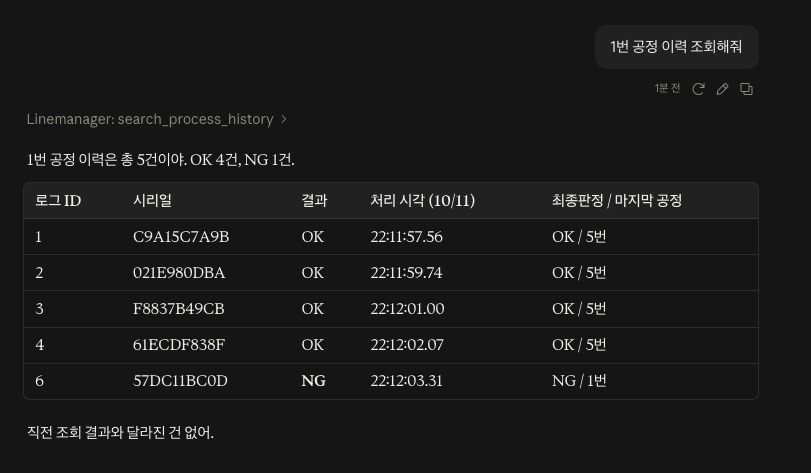
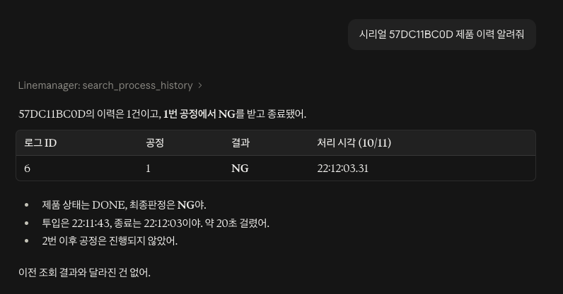
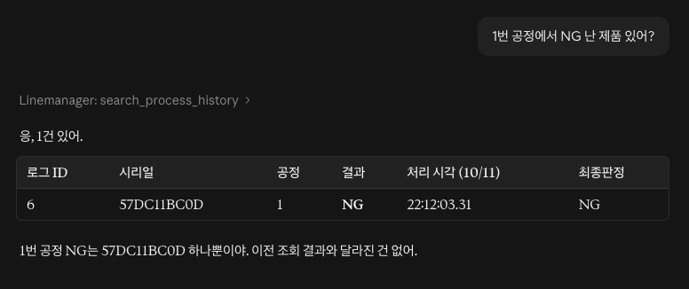
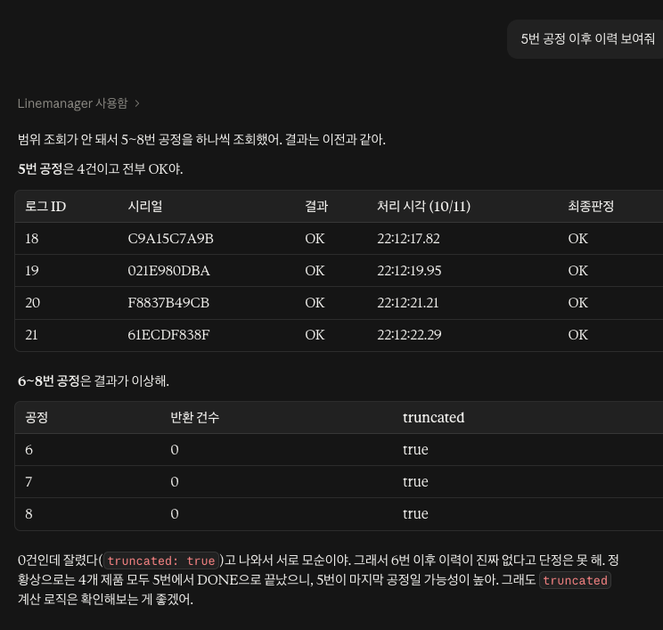
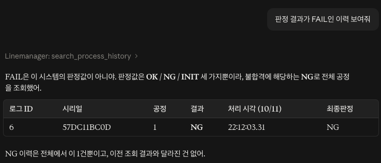
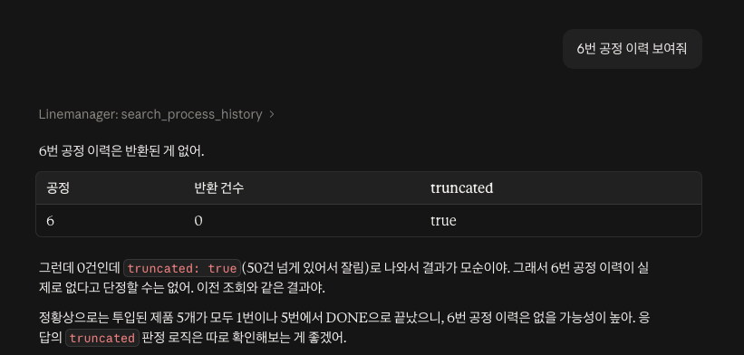
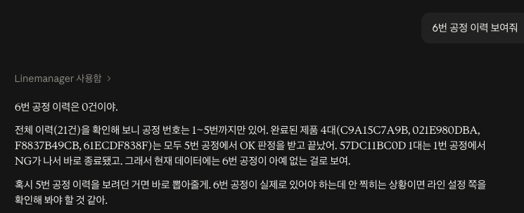

# linemanager-mcp

MES 공정 이력 API(linemanager-api)를 **MCP 서버로 노출**해, Claude에게 자연어로 조회시키는 Spring Boot 프로젝트입니다.

> "1번 공정에서 NG 난 제품 있어?" → Claude가 도구를 호출하고, 실제 DB 데이터를 근거로 답합니다.

- 기존 API 코드는 수정하지 않고, HTTP + JWT로만 호출합니다.
- **조회 전용**입니다. 수정·삭제 도구는 만들지 않았습니다.

## 기술 스택

| 구분 | 내용 |
|---|---|
| Language | Java 21 (toolchain) |
| Framework | Spring Boot 4.1, Spring AI 2.0.1 (`spring-ai-starter-mcp-server`) |
| HTTP Client | Spring `RestClient` |
| MCP Transport | STDIO |
| 연동 대상 | linemanager-api (Spring Boot 4, Spring Security + JWT, QueryDSL, MySQL) |
| Client | Claude Desktop |

## 구조

```
Claude Desktop ──(STDIO, MCP)──▶ linemanager-mcp (이 프로젝트, jar)
                                      │
                                      │ HTTP + JWT
                                      ▼
                                 linemanager-api ──(SQL)──▶ MySQL
```

| 주체 | 역할 |
|---|---|
| Claude | 질문 해석, 도구·파라미터 선택, 결과를 읽고 답변 작성 |
| Claude Desktop | MCP 서버 jar 실행, 메시지 중계 |
| **linemanager-mcp** | 도구 등록, 입력 검증, 로그인·토큰 관리, API 호출, 페이지 수집, 결과 제한 |
| linemanager-api | JWT 검증, QueryDSL 조회 |

### 패키지 구성

```
com.llm.demo
├── tool/ProcessHistoryTool      # @McpTool. Claude가 호출하는 입구 (컨트롤러 역할)
├── client/LinemanagerClient     # 로그인, 토큰, HTTP 요청 (서비스 역할)
└── dto/                         # API 응답 JSON을 받는 record
    ├── ProcessHistoryResponse
    ├── ProcessLog
    └── Product
```

## 동작 흐름

질문 하나가 처리되는 순서입니다.

1. Claude가 질문을 보고 `search_process_history`를 `processNo=1, result=NG`로 호출
2. `ProcessHistoryTool.searchProcessHistory()` 실행 → `result` 값 검증
3. `LinemanagerClient`가 토큰이 없으면 `POST /login`으로 로그인, 응답 헤더의 JWT 저장
4. `GET /api/history/process`를 페이지 단위로 호출 (한 페이지 20건)
5. 최대 50건까지 모아서 `SearchResult(returnedCount, truncated, logs)` 반환
6. Claude가 결과를 읽고 표·문장으로 정리해 답변

토큰이 만료돼 401/403이 오면 한 번만 재로그인 후 재시도합니다.

## 제공 도구

### `search_process_history`

| 파라미터 | 타입 | 설명 |
|---|---|---|
| `serialNumber` | string | 제품 시리얼 번호 (선택) |
| `processNo` | integer | 공정 번호, 정확히 일치 (선택) |
| `result` | string | `OK` / `NG` / `INIT` 중 하나 (선택) |

- 여러 조건은 AND로 적용됩니다.
- `3번 이후 공정` 같은 범위 조건은 지원하지 않습니다.
- 결과는 최대 50건이며, 더 있으면 `truncated: true`입니다.
- `readOnlyHint = true`, `destructiveHint = false`로 조회 전용임을 명시했습니다.

## 설계 결정

| 결정 | 이유 |
|---|---|
| 기존 API 무수정, HTTP로만 호출 | 검증·권한 로직을 linemanager-api 한 곳에 유지 |
| MCP 서버에 DB 의존성 없음 | DB 접근 경로를 하나로 제한. 초기 생성 시 들어간 JPA 의존성을 제거 |
| 조회 전용 | LLM이 데이터를 변경할 수 있는 경로를 만들지 않음 |
| 로그인 정보는 환경변수 | 비밀번호가 코드·저장소에 남지 않음 |
| description + 코드 두 겹 검증 | LLM 안내만으로는 보장되지 않는 규칙(`result` 값)을 코드로 한 번 더 막음 |
| 결과 50건 제한 + `truncated` | 응답 크기 제한, 잘린 결과를 전체인 것처럼 답하지 않도록 신호 제공 |
| 도구와 클라이언트 분리 | 도구 추가 시 로그인·토큰 코드를 재사용 |

## 데모 및 검증

Claude 답변을 같은 조건의 Swagger(linemanager-api) 조회 결과와 대조했습니다.

### 정확도

| # | 질문 | Claude 답변 | 실제 데이터 | 결과 |
|---|---|---|---|---|
| 1 | 1번 공정 이력 조회해줘 | 5건 (OK 4, NG 1) | 5건 (OK 4, NG 1) | ✅ |
| 2 | 시리얼 57DC11BC0D 제품 이력 알려줘 | 1번 공정 NG 1건, 이후 공정 없음 | 로그 id 6, 1번 공정 NG | ✅ |
| 3 | 1번 공정에서 NG 난 제품 있어? | 57DC11BC0D 1건 | 동일 | ✅ |





### 한계 처리

| # | 질문 | Claude 반응 |
|---|---|---|
| 4 | 5번 공정 이후 이력 보여줘 | 범위 조회 미지원을 인지하고 공정 번호를 하나씩 조회 |
| 5 | 판정 결과가 FAIL인 이력 보여줘 | FAIL은 없는 값이라고 설명하고, NG로 해석했음을 밝힌 뒤 조회 |




### 사실과 추론의 구분

1번 질문에서 Claude는 "이 라인에 투입된 제품은 이 5개가 전부인 걸로 보인다"고 덧붙였습니다. 이는 도구가 반환한 데이터가 아니라 Claude의 추론입니다. 검증 시 조회 사실(건수·시리얼·판정)과 모델의 해석을 분리해 확인했습니다.

## 트러블슈팅

### 1. 테스트 중 발견한 버그: 빈 결과에서 `truncated: true`

4번 테스트에서 6~8번 공정을 조회하자 `0건, truncated: true`가 반환됐고, Claude가 "0건인데 잘렸다는 것은 모순"이라고 지적했습니다.

- **원인**: 빈 페이지에서 `break`로 반복을 빠져나와 `page`가 증가하지 않았고, `page <= totalPages` 조건이 참으로 남음
- **수정**: 50건을 넘었거나, 50건을 채운 상태에서 페이지가 남았을 때만 `truncated`로 판단

```java
boolean truncated = collected.size() > MAX_RESULTS
        || (collected.size() >= MAX_RESULTS && page <= totalPages);
```

| | 수정 전 | 수정 후 |
|---|---|---|
| 6번 공정 조회 | 0건, `truncated: true` → Claude가 결과를 단정하지 못함 | 0건 → Claude가 전체 이력을 확인하고 공정이 1~5번뿐임을 근거로 답변 |




### 2. STDIO에서는 stdout이 통신 채널

STDIO 방식에서는 stdout으로 MCP 메시지가 오가므로, 배너나 콘솔 로그가 섞이면 연결이 깨집니다. 배너와 콘솔 로그를 끄고 로그는 파일로 분리했습니다. Claude Desktop의 작업 디렉터리는 `/`이므로 로그 경로는 절대 경로로 지정해야 합니다.

### 3. 의존성 정리

- 프로젝트 생성 시 포함된 JPA 때문에 DataSource 설정이 없다는 오류로 시작 실패 → JPA·Security 제거
- Security가 간접적으로 제공하던 `spring-web`이 함께 빠져 `RestClient`를 찾지 못함 → `spring-web` 명시
- `RestClient.Builder` 빈을 만드는 자동 설정 모듈이 없어 주입 실패 → `RestClient.builder()`로 직접 생성

### 4. 코드 수정 후 반영 순서

jar를 다시 빌드해도 실행 중인 서버에는 반영되지 않습니다.

1. `./gradlew bootJar`
2. Claude Desktop 완전 종료(Cmd + Q) 후 재실행
3. 새 대화에서 테스트 (기존 대화는 재시작 시 도구 연결이 끊김)

## 실행 방법

### 사전 조건

- linemanager-api 실행 중 (`http://localhost:8080`)
- linemanager-api 테스트 계정 (`POST /join`으로 생성)
- Java 21 이상, Claude Desktop

### 빌드

```bash
./gradlew bootJar
```

`src/main/resources/application.properties`의 `logging.file.name`은 본인 환경의 절대 경로로 수정하세요.

### Claude Desktop 등록

`~/Library/Application Support/Claude/claude_desktop_config.json` (macOS)

```json
{
  "mcpServers": {
    "linemanager": {
      "command": "/usr/bin/java",
      "args": ["-jar", "/절대경로/build/libs/linemanager-mcp-0.0.1-SNAPSHOT.jar"],
      "env": {
        "LINEMANAGER_USERNAME": "테스트계정",
        "LINEMANAGER_PASSWORD": "비밀번호"
      }
    }
  }
}
```

Claude Desktop 재시작 후 설정 → 개발자 탭에서 `linemanager`가 실행 중인지 확인합니다.

## 한계와 다음 단계

- 공정 번호 범위 조건 미지원 (API가 단일 값만 지원)
- API가 전체 건수를 제공하지 않아 50건 초과 시 정확한 총계를 알 수 없음
- 다음 단계: 백엔드가 Claude API를 직접 호출하는 에이전트 루프 구현 (`LinemanagerClient` 재사용)
